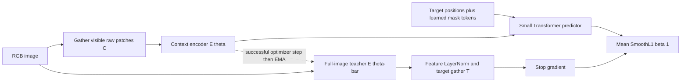
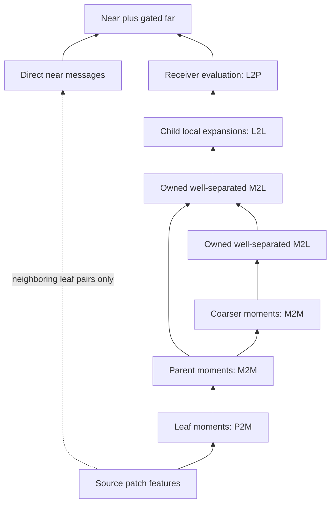

# Architecture, mathematical contracts, and costs

The implementation is a reusable notebook-backed Python package. Tagged definition cells in `fmm_jepa/geometry.ipynb`, `operators.ipynb`, `models.ipynb`, `data.ipynb`, `training.ipynb`, and `evaluation.ipynb` provide the respective modules after the explicit `bootstrap.ipynb` loader is installed. Imports never execute upstream experiment cells. Module names and schema versions are checked by the handoff; source hashes identify the exact definitions used in a run.

## Teacher, context, and predictor

Let an RGB image batch have shape `[B,3,H,W]`, square patch width `s`, and rectangular patch grid `(R,Q)=(H/s,W/s)`. Both image dimensions must divide by `s` exactly; image-pixel padding is not implicit. There are `N_grid=RQ` original positions, in row-major order `i=row*Q+col`, with center `x_i=((col+1/2)/Q,(row+1/2)/R)` in `[0,1]^2`.

For sample `b`, `C_b` denotes visible original indices and `T_bk` the indices of target block `k`. The union of targets is excluded from context. Context indices have packed shape `[B,V]`, values `-1` at padded slots, and Boolean validity `[B,V]`. Each target block has its own `[B,T_k]` indices and validity. Valid indices are unique within a sample/block; different target blocks may intentionally overlap. Encoder output `[B,V,D]` follows the supplied index order exactly, rather than reassigning compact positions as new spatial coordinates. Invalid outputs are zero.

The encoder unfolds raw pixels and **gathers visible patches before learned patch embedding**. Raw unfolding still touches the full image and allocates `O(B N_grid 3s²)` values, but hidden patches never become student feature tokens. Fixed Fourier position features use the original normalized patch centers. The target encoder processes the complete grid.

With `z_C=E_theta(x_C;C)` and `z_Tk=[E_theta-bar(x;I)]_Tk`, the predictor outputs `zhat_Tk=P_phi(z_C,C,Tk)`. It projects context into predictor width, adds original positions, appends position-plus-mask tokens, runs conventional attention blocks, and returns only target slots `[B,T_k,D]` in requested order. It never receives `z_Tk` as input.

Define `a_bktd = zhat_bktd - stopgrad(LN(z_T)_bktd)`. With `rho(a)=a²/2` for `|a|<1` and `|a|-1/2` otherwise, the implemented loss is

`L = (1/K) sum_k (1/B) sum_b [sum_(t valid,d) rho(a_bktd) / (D * |T_bk|)]`.

Every sample and block gets equal weight; valid positions and features are averaged within it. For unequal target lengths this differs from pooling all valid elements into one mean. Feature LayerNorm uses no additional learned target-affine parameters and precedes target selection. The [source review](references.md) explains why beta 1 SmoothL1 follows pinned official code even though the original paper writes squared L2. This is latent prediction, not pixel reconstruction or a negative-example/InfoNCE objective.

The teacher starts as an exact frozen deep copy. After a successful student/predictor optimizer step, `theta-bar <- m*theta-bar + (1-m)*theta`; skipped/nonfinite steps must not advance EMA. Floating/complex teacher buffers use the same average and integer buffers copy the student. The teacher remains in eval mode even when the wrapper enters train mode. Current blocks have no dropout, stochastic depth, or running-statistic normalization, but this explicit policy prevents later accidental drift. Teacher parameters are excluded from the optimizer and gradient tests require them to have no gradients.

## Masks and boundary cases

`sample_masks` uses a checkpointable CPU generator. Defaults are two target rectangles, context proposal area 0.65–0.90, target proposal area 0.08–0.18, and target aspect 0.5–2.0. These small-grid smoke defaults differ from the paper's larger-image recipe. Discrete rounding/clipping changes realized area and aspect; report realized counts.

A randomly chosen per-sample anchor is excluded from every target, ensuring a possible nonempty context. Target proposals use at most 32 retries, then a singleton other than the anchor. Context is a proposed rectangle minus the target union; its bounded fallback is the anchor. Target-target overlap is allowed, context-target overlap is never allowed. Padding retains variable lengths rather than truncating all samples to the shortest context. Fallback use belongs in mask metadata. The mask diagram and hidden-pixel perturbation test in Notebook 00 expose this behavior directly.

## Geometric hierarchy and unique interaction ownership

Geometry depends only on grid shape and hierarchy settings. A leaf contains at most `b×b` original patches (`b=leaf_size`). Let `S=next_power_of_two(max(ceil(R/b),ceil(Q/b)))`; allocate an `S×S` leaf lattice and all parents. Root level is zero, leaf depth `L=log2(S)`, and allocated cells are `C_alloc=sum_(l=0)^L 4^l=(4^(L+1)-1)/3`.

The physical root spans width `bS/Q` and height `bS/R`; it can extend past the actual image domain. Level-l cells have width `bS/(2^l Q)` and height `bS/(2^l R)`. This preserves patch coordinates on rectangular grids while representing padded/empty cells explicitly. No fictitious padded patch is inserted as a source. An empty source cell has zero moments; it may receive local expansions but is never evaluated at a valid patch unless a real patch belongs there.

Two leaves are near if their row/column cell differences are each at most one. The learned near operator includes self-interactions. A level-l cell pair is a far interaction exactly when their parents are neighbors but the two cells are not neighbors. Such pairs appear only from level 2 onward, with at most 27 source cells per receiving cell in 2-D.

For a distant ordered source/receiver pair, descend from their common near ancestors until the first level where the cells cease to be neighbors. That level owns the pair; every deeper pair has non-neighbor parents and cannot own it again. Pairs whose leaves remain neighbors belong only to the direct near field. A tiny exhaustive ownership table tests this argument, including rectangular/padded cases. It is diagnostic-only and cannot enter the production path.

## Chebyshev coefficients and transfer direction

Order `p` means **p first-kind Chebyshev nodes per axis**, not polynomial degree or total coefficient count. One-dimensional nodes are `cos((2k+1)pi/(2p))`, sorted ascending. Each cell has `r=p²` tensor-product nodes. Let `ell_a^c(x)` be the cardinal polynomial basis attached to cell c, so it is one at node a, zero at the other nodes, and sums to one. A field polynomial of degree at most `p-1` in each coordinate is reproduced exactly in exact arithmetic.

For projected feature `v_j` with D channels, the leaf moment is `M_c[a,d]=sum_(j in c) ell_a^c(x_j) v_j[d]`. Moments at one level have shape `[B,C_l,r,D]`; scalar diagnostic charges use D=1. These coefficients are weighted source sums (anterpolation), not simple mean pooling.

For child quadrant q, store `T_q[a,b]=ell_a^parent(x_b^child)` with shape `[4,r_parent,r_child]`. The directions are:

- **M2M upward:** `M_parent[a,d] += sum_b T_q[a,b] M_child[b,d]`.
- **L2L downward:** `L_child[b,d] += sum_a T_q[a,b] L_parent[a,d]`, using the transpose action.
- **M2L:** `L_c[a,d] += sum_b K_cd[a,b] M_d[b,d]` for uniquely owned far cell pairs.
- **L2P:** `m_far_i[d] = sum_a ell_a^leaf(x_i) L_leaf[a,d]`.

The fixed transfer identity follows because a parent cardinal polynomial restricted to a child is still degree at most `p-1` per coordinate. Float64 certificates test cardinality, partition of unity, polynomial reproduction, direct-versus-transferred moments, local-field transfer, boundaries, and small autograd finite-difference checks. An identity in exact arithmetic is not an automatic tolerance guarantee at every p/dtype.

In the classical diagnostic, `K_cd[a,b]=1/sqrt(||x_a^c-x_b^d||²+epsilon²)` and near pairs use that exact kernel, excluding self-pairs. Compare the hierarchical result with the explicitly bounded dense reference using absolute errors and `||u_hier-u_exact||₂ / max(||u_exact||₂,delta)`. Fixed fixtures at p=2,4,6 probe order sensitivity; signed-charge cancellation and finite precision can prevent strict monotonicity. These are measurements for the stated fixtures.

## The learned near/far mixer

For visible receiver i and valid neighboring source j, the near message is

`m_near_i = [sum_j sigmoid((Wq h_i)·(Wk h_j)/sqrt(D) + w_delta·(x_i-x_j)) Wv h_j] / max(valid_near_degree_i,1)`.

This is a content-dependent sigmoid-weighted operator, not locally normalized softmax attention. Self is included; absent source/receiver edges are zero. The value projections have no bias so zero-filled absent patches remain zero before P2M.

The far branch projects features with a shared `D×D` map, follows all five transfer stages, and replaces the classical M2L kernel with a learned matrix bank `[49,r,r]` indexed by relative cell offsets in `{-3,...,3}²`. Only well-separated offsets are used, but all 49 matrices count as parameters. Matrices are shared across levels and initialized from a regularized radial kernel in cell-normalized coordinates. This initialization is not a physical-space kernel on every rectangular level.

The evaluated far field is divided by the sample's visible-token count and, by default, multiplied channelwise by `sigmoid(Wg h_i+b_g)`. A shared output projection maps `m_near+m_far`. The enclosing block is `u=h+Mixer(LN(h))`, then `h'=u+MLP(LN(u))`, with MLP hidden width 4D. Invalid packed outputs are re-zeroed. The FMM encoder contains no global attention fallback; declared attention exists in the ViT comparator and predictor.

Learned translations, channel maps, the near normalization, far visible-count normalization, and receiver gate deliberately depart from a fixed classical kernel. They preserve an explicit multilevel information path and fixed interpolation primitives, but not a classical approximation theorem. Spatial proximity is not semantic proximity. Feature-valued moments, receiver gates, and residual pathways may help learning, yet two distant patterns can map to the same compressed coefficients. The gate cannot reconstruct information already lost in a source moment. Semantic routing, exception edges, feature-space trees, and added global attention remain separately registered future ablations.

## Cost derived from the executed operations

Let V be packed context length, N_vis the sample's valid-token count, `N=N_grid`, `C=C_alloc`, E_near the stored original-patch near edges, E_far the sum of owned cell interactions, and r=p². The current FMM mixer scatters visible features onto a full `[B,N,D]` lattice. It traverses padded/empty cells as well as occupied cells, so its runtime is not solely proportional to N_vis.

| Operation | Leading work in the implemented form |
| --- | --- |
| Visible patch embedding and block MLPs | `O(B V 3s²D)` embedding; `O(B V D²)` MLP/scaffolding per block |
| Full-grid mixer feature projections | `O(B N D²)` |
| Near edge scores/aggregation | `O(B E_near D)`, with `E_near <= 9b²N` |
| P2M and L2P | `O(B N rD)` |
| M2M plus L2L | `O(B (C-1) r²D)` per pass, with two passes |
| M2L dense coefficient matrices | `O(B E_far r²D)`, `E_far <= 27C` |
| Receiver gating / output projection | `O(B N D²)` gate and `O(B V D²)` packed output |

The main arithmetic bound is `O(B[N D² + E_near D + N p²D + (C+E_far)p⁴D])` plus block scaffolding. Hierarchy depth creates a sequential dependency chain of L upward/downward stages; the sum of cells is geometric, so the transfer operation count is a sum over levels rather than automatically `N*L`. Python dispatch, gather/scatter, autograd storage, and small dense kernels can dominate measured runtime.

Moment/local activations occupy `O(B C rD)`. Gathered M2L matrices occupy `O(E_far r²)` and edge-message temporaries `O(B E_far rD)`; near temporaries require `O(B E_near D)`. The shared learned M2L parameter bank has `49p⁴` scalar parameters per mixer regardless of N. Geometry also stores `O(Cr)` node positions and `O(Nr)` interpolation weights. A bounded geometry cache retains up to 24 configurations, keyed by grid, order, leaf size, device, and dtype. Visibility is not in this key because the cached objects contain no visibility-dependent or feature-dependent state. Moments/locals/edge validity are rebuilt each call; features must never enter the cache.

For fixed p, D, b and bounded grid aspect ratio, C is proportional to padded area, yielding favorable token-count arithmetic. For very thin rectangles, square-lattice padding can make `C=O(max(R,Q)²/b²)` much larger than `RQ/b²`; do not claim linearity in N for arbitrary aspect-ratio families. Increasing p has a quartic coefficient-translation cost in this unspecialized implementation.

Attention's pairwise arithmetic is `O(B V²D)` plus `O(B V D²)` projections/MLP. Optimized attention need not materialize an entire score matrix, so mathematical pair counts alone do not establish runtime or memory superiority. The predictor performs attention on context-plus-target slots for each block, and the teacher performs a full-grid encoder pass. Full-JEPA timing includes these, gradients, optimizer, and teacher update as declared by the measurement boundary. A favorable encoder-mixer bound is not a whole-system linear-time claim.

## Verification is bounded evidence

The notebook links geometry, hierarchy, ownership, transfers, classical error, nonzero near/distant effects, masks/leakage, shape alignment, finite gradients/updates, teacher isolation/EMA, deterministic execution, no hidden all-pairs production work, and checkpoint resume to real tests. No-all-pairs evidence combines code-path inspection, bounded edge counts and profiler/operation-shape inspection where available; searching for a text spelling of `N*N` is insufficient.

Actual outcomes, tolerances, supported tested devices/dtypes, parameter counts, measured bottlenecks, and readiness are run artifacts rather than claims baked into this theory document. The remaining research questions are useful learning, quality/cost advantage, generalization, whole-system scaling, and novelty.
