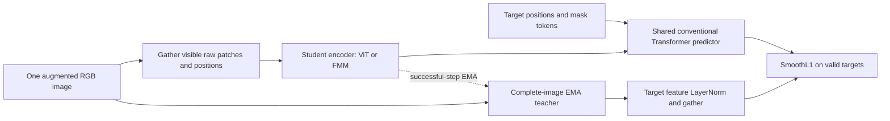
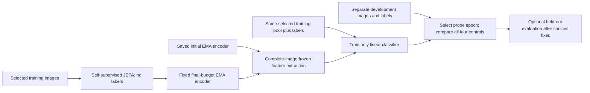

# Notebook 01: registered Tiny ImageNet comparison

This document specifies the experiment before the primary comparison is collected. Each execution must save its resolved configuration, parameter counts, data/split identities, exported-source hashes and choices in its own `protocol.json` **before training**. That immutable run artifact is authoritative if a clearly declared hardware fallback changes the defaults below. Changing a choice requires a new run ID and a reason; unfavorable results remain intact.

The question is whether the verified FMM-JEPA implementation learns useful representations from real images, and whether its training/evaluation can be reproduced against a comparable ViT-JEPA. Three conclusions remain separate: engineering correctness; useful learning relative to the same encoder's untrained initialization; and an architectural quality–compute advantage. A declining JEPA loss, nonzero far branch, or score above chance establishes none of the latter two on its own.

Only Notebook 01 is implemented here. Food-101, COCO, ImageNet-1K, video/action conditioning, AHR integration, semantic routing, and a new FMM predictor remain outside this task. No later dataset or notebook is automatically launched. A successful smoke run is integration evidence, not a learning pilot.

## Predecessor and implementation contract

The predecessor is Notebook 00 run `20260923T163118Z-57c8d609`. Its artifact/config schemas are `fmm-jepa-artifact/v1` and `fmm-jepa-config/v1`; the tagged package version is `0.1.0`. Notebook 01 uses configuration `fmm-jepa-tiny-config/v1`, artifacts `fmm-jepa-tiny-artifact/v1`, data `fmm-jepa-tiny-data/v1`, and training checkpoints `fmm-jepa-tiny-checkpoint/v1`. Execution records actual code hashes rather than treating version strings as sufficient evidence.

Preflight compares the handoff's exported-source hashes against current core notebooks and reruns geometry, interpolation/transfer, ownership, padding, hidden-pixel isolation, forward/backward, predictor alignment, teacher/EMA and checkpoint recovery tests. Essential failure blocks integrated training while allowing independent dataset/evaluation work. Synthetic-trained predecessor weights are never used as representation controls or initialization.

The user's notebook-only agreement takes precedence over the brief's example `.py` layout. Executable project definitions live in tagged `ahr-export` cells. Consumers execute only the shared bootstrap definitions and then use ordinary imports such as `from fmm_jepa.models import JEPA`. Importing never runs training or Notebook 00. Shared Notebook 01 APIs live in `fmm_jepa.tiny_imagenet`, `fmm_jepa.tiny_training`, `fmm_jepa.tiny_evaluation`, and the workflow/figure modules. Tests likewise live in notebooks, and the same notebook entry point launches smoke or an explicitly requested pilot.

## Objective, shapes, and information isolation

An augmented image batch has shape B×3×64×64. Patch size 8 gives an 8×8 lattice with 64 positions. Every patch retains its original row-major ID and center coordinate `((column+0.5)/8, (row+0.5)/8)`. Context indices and Boolean validity have shape B×V; each of four target blocks has its own B×T_k indices and validity. Padding uses −1 with an explicit false validity flag, never a real patch.

For image x, visible context C and target block T_k:

\[
z_C=E_\theta(x_C;C),\qquad
y_k=\operatorname{stopgrad}\!\left([\operatorname{LN}_0(E_{\bar\theta}(x))]_{T_k}\right),\qquad
\hat y_k=P_\phi(z_C,C,T_k).
\]

The encoder's learned final LayerNorm is already part of E. `LN_0` is the additional nonaffine feature LayerNorm inherited from the JEPA target objective. The teacher sees the complete **same augmented image** used by the student. The student unfolds raw patches and gathers visible pixels before learned embedding or mixing. Target features are never predictor inputs: the conventional Transformer predictor receives context features, original context positions/validity, target positions/validity, and the grid. Target positions receive learned mask tokens plus positional features.

Let D be encoder width and n_bk the valid target count for image b/block k. All registered masks have nonempty targets and context. The exact inherited loss is

\[
\mathcal L=\frac1{BK}\sum_{b=1}^B\sum_{k=1}^K
\frac1{Dn_{bk}}\sum_{t\in T_{bk}}\sum_{d=1}^D
\operatorname{SmoothL1}_{\beta=1}(\hat y_{bktd},y_{bktd}),\quad K=4.
\]

Each image and target block receives equal weight; valid positions/features are averaged within that image/block. This differs from pooling all variable-length targets into one length-weighted mean. Padding contributes zero. Target blocks may overlap, and a position appearing in multiple blocks intentionally participates in each corresponding block loss. Context excludes their union. Labels enter stratified sampling and frozen evaluation only; the actual pretraining-forward function does not read them. No reconstruction, classification, contrastive term or extra collapse regularizer is added.

Following a successful optimizer step, the teacher receives `teacher = m*teacher + (1-m)*student`. It has no gradients or optimizer parameters and stays in evaluation mode. Floating buffers follow EMA; integer buffers are copied. This is a declared state-update rule, not a mathematical guarantee against collapse.

## Actual FMM mixer and native geometry

The near branch performs learned, content-dependent sigmoid-weighted interactions within neighboring leaves. It includes self interactions and divides a receiver's aggregate by its valid near-neighbor count. This is the inherited bounded-neighborhood sigmoid operator, not a softmax-attention approximation.

The far branch projects source features without bias, forms Chebyshev interpolation moments by P2M, transfers moments upward by M2M, applies learned M2L matrices for well-separated cell offsets, transfers local values downward by L2L, and evaluates leaf expansions by L2P. P2M/M2M/L2L/L2P use fixed geometric interpolation coefficients. M2L matrices, feature projections, receiver gates and the shared output projection are learned. Far output is divided by the image's visible source count and multiplied by an optional learned sigmoid receiver gate. The mixer returns a projection of `near + far`; residual and MLP scaffolding surround it. No dense global-attention fallback is inserted.

Default leaves are 2×2 patches, with Chebyshev cell-neighborhood radius one. The complete native grid allocates levels of 1, 4 and 16 cells: depth two, 21 allocated cells, all occupied on complete images. There are 1,600 ordered near point pairs including self and 156 directed M2L cell pairs. Masks change valid occupancy and effective pair activity; allocated topology remains fixed and its overhead is reported.

Order p=4 means four nodes **per coordinate axis**, hence r=p²=16 nodal coefficients per cell/channel, not four coefficients. There are 49 stored r×r relative-offset translation matrices per mixer, shared across levels; inherited matrices for unused offsets still count toward actual parameters. This storage was not added to fake capacity matching.

At this depth, genuine well-separated M2L interactions occur only at leaf level two. Upward/downward operations exist, but the native grid has no coarser-level M2L signal to propagate. A separate inherited depth-three fixture verifies coarser routing; native Tiny ImageNet alone is not evidence of useful coarse multilevel semantics. Geometry identities and classical smooth-kernel convergence do not guarantee that learned far summaries preserve semantic information.

## Data provenance, separation, and pairing

The intended source is `thethinkmachine/tiny-imagenet`, pinned at source revision `9f4331d7160a7f6e90c12e3533d658e9c8c7ae3c`; converted Parquet revision is `5318f3a410192b1480adce2ea61e8e2c139adb53`. Actual split names are `train` and `valid`, with 100,000 and 10,000 labeled examples, respectively. All 200 class mappings match. Supported Parquet is read with PyArrow; no remote loader code runs. Converted shards lack embedded ClassLabel metadata, so pinned source metadata and both Viewer split schemas are cross-checked, and converted-file SHA-256 values must match original source LFS hashes.

All 110,000 images decoded at native 64×64 without failures. There are 1,821 grayscale training and 168 grayscale validation images; every selected image is explicitly converted to RGB. Compressed source download is 161,067,911 bytes, independent of how many examples are selected or exposed to optimization. Public/ungated API status and the card's empty license field plus ImageNet access terms are preserved without inferring broader permission. See [the data contract](tiny_imagenet_data.md) for complete evidence.

Split seed 314159 first reserves 50 source-training examples per class for development and 450 for training. A predeclared decoded-RGB duplicate rule prioritizes held-out, then development, then training, retaining the lowest original row within the winning partition. All 27 duplicate pairs have conflicting source class labels; excluded copies are recorded and retained labels are not changed. The result is 89,975 training-pool, 9,998 development-pool and 10,000 held-out examples. There are no remaining exact duplicates across retained partitions; near/semantic duplicates remain unaudited. Source-validation decoding is restricted to integrity/duplicate checking in smoke, with no predictive evaluation or normalization fitting.

Subset seed 1702 chooses class-balanced subsets from these separated pools. IDs encode the pinned repository/revision, original split and original row. Exact pool/subset IDs and hashes are saved. The selected pretraining pool also supplies labeled probe training, intentionally. Development is excluded from encoder pretraining. Both models and all four representation controls use the same membership manifests.

Registered seeds are model initialization 20260924, data order 1101, augmentation 2202, masks 3303, probes 4404, and paired bootstrap 5505. Data order is a local per-epoch permutation. Augmentation/masks are separately keyed by stable sample ID, occurrence and stream seed, so model/global RNG consumption and evaluation cannot change future inputs. The consumed cursor uses zero workers and no prefetch. A comparison must verify equal actual exposures and paired traces; asymmetric failed attempts can consume different data even if successful-update totals agree and must invalidate an unqualified equal-data claim.

Training preprocessing uses a random resized crop to 64 with area 0.6–1.0, aspect 0.75–4/3, PIL bilinear interpolation and horizontal flip probability 0.5. Mean and standard deviation are fixed at (0.5,0.5,0.5), with no learned statistics. Evaluation uses the full native image and deterministic normalization. No strong color/blur policy is registered.

The verified core mask sampler proposes four targets with area 0.15–0.20 and aspect 0.75–1.5, plus context area 0.85–1.0. After removing target unions, at least four context tokens are required. Complete masks retry at most 16 times; rectangle retries are capped at 32. A final declared fallback repeats one 3×3 target four times and uses its 55-token complement as context. Actual integer shapes, area fractions, retries and fallback use are recorded. No fallback permits context/target overlap.

## Paired models and execution budgets

The default CUDA architecture is the candidate pilot architecture: patch size 8, encoder width 192/depth 4, MLP ratio 4, three ViT attention heads, FMM order 4/leaf size 2, and predictor width 128/depth 2/four heads. Both encoders share the positional representation, normalization, residual/MLP scaffold, objective and predictor. Optimized PyTorch scaled-dot-product attention is used, with Boolean padding semantics and explicit `dropout_p=0`; actual dispatcher events must be recorded rather than assuming a FlashAttention backend.

Both models initialize fresh. Identically shaped nonmixer context components and the entire predictor are copied from ViT initialization into FMM with independent storage; each teacher is then copied from its own student. Immutable initial teacher and full-model states are saved before training. Count real trainable parameters and frozen-teacher bytes separately. This is a **same-scaffold**, equal-update/equal-data comparison, not capacity matching or equal compute.

| Profile | Train/dev subset | Successful updates/model | Microbatch × accumulation | Planned image exposures/model | Probe epochs |
|---|---|---:|---:|---:|---:|
| Default CUDA smoke | 2,000 / 1,000 | 20 | 4 × 2 = 8 | 160 | 2 |
| Explicit pilot | 20,000 / 2,000 | 5,000 | 8 × 16 = 128 | 640,000 | 30 |
| Explicit full pool | 89,975 / 9,998 | 5,000 | 8 × 16 = 128 | 640,000 | 30 |
| CPU smoke fallback | 2,000 / 1,000 | 4 | 2 × 1 = 2 | 8 | 2 |

Planned exposures assume no rejected attempts; actual successful/attempted updates and exposures are always reported. CPU smoke reduces encoder/predictor width to 32, depth to one, and heads to four; its changed architecture and limits are recorded. World size is one. Models run sequentially on one device. Pilot/full-pool and additional seeds require explicit selection and are not launched merely because a GPU exists. Patch size four is a different protocol affecting both models and is not automatically run.

AdamW uses LR 3×10⁻⁴ and decay 0.05. Biases and one-dimensional parameters, including normalization scales, have zero decay; exact groups are saved. The first max(1, ceil(0.05T)) successful updates linearly warm up; cosine decay reaches zero at update T. EMA follows cosine interpolation from 0.996 at update one to 1.0 at update T. These zero-LR/unit-EMA endpoints are explicit choices. Global gradient clipping is 1.0. Each equal-size microbatch loss is divided by the accumulation count; partial accumulation is rejected and full batches can cross epochs. Schedules and EMA advance only after successful optimizer steps.

Only FP32 is enabled; TF32 is disabled and deterministic-algorithm settings are recorded. AMP/scaler state is explicitly `None`, pending separate operator dtype verification. Finite checks cover losses, relevant activations, gradients and updated parameters. Nonfinite pre-update attempts are logged and skipped without schedule/EMA advancement; three consecutive failures stop the run. Nonfinite post-update state stops without overwriting the last valid checkpoint. Teacher gradients are forbidden. FMM caches contain geometry and detached statistics, not retained feature graphs.

## Frozen-feature evaluation and learning quantities

For complete-image EMA teacher outputs h_t after the encoder's learned final LayerNorm, the registered representation is `z(x)=mean_t h_t` over all 64 valid patches. Evaluation does not reuse the extra nonaffine target-loss normalization. There is no predictor or CLS token in this path. The four controls are trained ViT, initial ViT, trained FMM and initial FMM. No student-versus-teacher choice is made after seeing scores.

The classifier is `Wz+b` with 200 outputs, fitted using cross-entropy and AdamW, batch 256, LR 10⁻² and decay 10⁻⁴. Every representation receives the same initialization/minibatch seeds and entire registered epoch budget. Development top-1 selects the probe epoch; ties choose the earliest. This bounded selection is identical for all controls. Feature standardization is fitted on probe-training features only, with population standard deviations clamped at 10⁻⁶; it is reused unchanged for development/held-out. The encoder is frozen and evaluated in eval mode, and its tensor-state hash is checked before/after fitting.

Feature cache identity includes source revision, ordered IDs, actual encoder-state hash, encoder kind, preprocessing, pooling and normalization. Stale or corrupt caches are rejected. Save per-epoch loss/top-1/top-5, example/class counts, per-example top-five predictions, and model/seed/split/checkpoint identities. Complete inference caches and partial feature progress are distinct artifacts.

Report three separate percentage-point differences: trained-minus-initial ViT, trained-minus-initial FMM, and trained FMM-minus-trained ViT. Uniform 200-class guessing (0.5% top-1) is only a sanity reference. Use 1,000 paired bootstrap resamples of aligned evaluation-image predictions, with the registered seed. Their intervals describe image-sampling uncertainty conditional on trained models; they do not estimate training-seed variability. Development scores also served probe selection, so their uncertainty does not remove model-selection optimism. One paired seed remains a pilot.

Held-out evaluation is forbidden in smoke and disabled by default in pilot. It requires an explicit pilot flag after encoder checkpoint and probe choices are fixed. No architecture, stopping, normalization or probe choice may then be revised using held-out outcomes. Missing held-out results remain `NOT_RUN` with a reason.

## Diagnostics, performance, and recovery

Select one fixed development image per class (200 total) before comparison outcomes. At initialization, midpoint and final budget, measure raw embedding feature standard deviations, norms, between-image cosines, covariance eigenvalues/effective rank and token variation **across images at matching positions**. The covariance effective rank is `exp(-sum(q log q))`, with normalized nonnegative eigenvalues q and rank zero for zero total variance. Its ceiling is min(D, sample_count−1): 192 for the default width/200-image subset. Diagnostics precede optional probe standardization. Variance epsilon 10⁻¹² and rank-below-two warnings are advisory flags, not collapse theorems. Review their trajectories; EMA/LayerNorm do not establish noncollapse.

Record near/far message norms on real masks and representative parameter-gradient norms. Gradient clipping frequency and preclip global norms are separate from postclip branch norms. Nonzero activity demonstrates execution, not useful distant semantics.

Measure data/preprocessing, encoder forward, full accumulated JEPA forward/backward/update, feature extraction and probe fitting separately. Report actual N_grid/N_visible, precision, masks, microbatch, included work, median/dispersion/throughput and memory scope. Training summaries omit the first two successful updates; dedicated measurements synchronize CUDA around timed regions, and training event pairs are flushed at checkpoint boundaries. Actual inherited scalar diagnostics may also synchronize. Peak allocated GPU memory is allocator accounting, not total GPU/context or reserved memory; CPU peak tensor memory remains unmeasured. Separate model lifetimes and cache handling avoid attributing the other model's tensors to a run. A 64-token measurement does not establish asymptotic scaling or whole-JEPA linear runtime.

Checkpoints are atomic with one writer and retain the latest two valid resumable states plus best loss for recovery. Primary results always use the **final successful-update budget**, never a best-looking JEPA-loss checkpoint. Save model/student/teacher/predictor, optimizer, scheduler, EMA position, FP32/scaler policy, every RNG, consumed order cursor, stateless stream seeds/identities, attempted/successful counts, config/protocol/data/source/environment identities, metrics and traces. Save at stage/epoch boundaries and no less frequently than 250 optimizer steps or 15 minutes; default training intervals are five smoke or 100 pilot steps. Exact resume instructions and latest-valid manifests accompany each run. Invalid manifests or orphan checkpoints are not silently replaced.

Before any >15-minute execution, the bounded real-data recovery certificate must pass: four updates uninterrupted versus two-plus-two from fresh state, on controlled CPU FP32 with one thread and deterministic algorithms. Compare next IDs, augmentation/mask identities, losses, model/teacher/predictor, optimizer, scheduler and RNG states. An earlier two-thread exploratory FMM check differed by at most 3.28×10⁻⁷ despite equal losses/traces; its evidence is retained and not called bitwise recovery. The strict certificate does not guarantee bitwise identity on ordinary two-thread or CUDA runs, differing devices or software versions. Probe fitting has its own resumable epoch/update state; feature extraction saves partial progress.

The workspace is on the persistent boot disk, but instance-deletion policy is unverified. Final/best checkpoints must be copied off-instance with verified hashes before recycle/destruction. This task neither recycles the instance nor claims that off-instance export already occurred.

## Interpretation and readiness

Engineering gates E1–E14 report `PASS`, `FAIL` or `NOT_RUN` with evidence paths; learning evidence has a separate L1–L6 ledger. FMM losing to ViT is not a software-test failure. Missing measurements stay missing rather than becoming zeros or fabricated plot rows.

For smoke, report engineering behavior and four short-budget probe scores as integration checks. Learning remains unestablished regardless of chance performance or a favorable small delta. `learning_evidence` remains inconclusive, `ready_for_notebook_02=false`, and no readiness override is implied.

Default advancement to Food-101 requires essential engineering gates to pass, both registered real-data pilot budgets and identical frozen-control evaluations to finish, and evidence of useful FMM learning relative to its own initialization without unresolved degeneracy. It does **not** require FMM to beat ViT. If neither model improves, inspect shared budget/masking/probe settings before attributing failure to FMM. If ViT improves and FMM does not, report FMM-specific concern without a permanent-impossibility claim. FMM improvement plus slower runtime must both be reported.

Any explicit decision to proceed despite inconclusive learning is a separately documented `readiness_override`; it cannot silently convert evidence to positive. The handoff records completed/incomplete work, seeds, uncertainty, bottlenecks, checkpoint purposes and compatibility. A future Food-101 comparison starts fresh unless a separate transfer protocol is registered. No novelty, ImageNet-scale quality, robust multiseed advantage or semantic theorem is claimed here.
