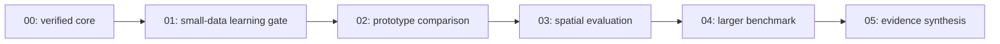

# FMM-JEPA: scope and evidence boundaries

This project asks whether a learned spatial Fast Multipole Method (FMM) token mixer can replace a Vision Transformer's dense self-attention inside an I-JEPA-style image encoder while preserving useful representations and improving the **measured** quality–compute–memory trade-off as token count increases. This is a hypothesis, not a result or a novelty claim.

The present assignment builds and executes only `00_FMM_JEPA_Core_Theory_and_Verification.ipynb`. It permits small synthetic optimization and bounded profiling. It does not authorize real dataset downloads, Notebooks 01–05, large training runs, paid compute, service deployment, or AHR model training. The pre-existing `00.ipynb` is not the new implementation or an upstream training dependency.

The user's explicit clarification preserves the workspace's notebook-only executable-code rule. Reusable Python definitions live in tagged `ahr-export` notebook cells. An explicit bootstrap loads only those definitions into named `fmm_jepa` modules; subsequent notebook cells use ordinary imports. The package is a versioned notebook-backed module namespace, not a conventional `.py` package or an installable wheel. No `%run`, implicit execution of another notebook's experiments, or hidden kernel history is part of the contract. Documentation and configuration files are ordinary non-executable files.

## Six notebooks and their gates

| Notebook | Responsibility | Required output / boundary |
| --- | --- | --- |
| `00_FMM_JEPA_Core_Theory_and_Verification.ipynb` | Theory, shared implementation, numerical/software certificates, synthetic steps, initial profiling | Reusable exports, configs, verified evidence, synthetic checkpoint, handoff. Does not prove useful learning. |
| `01_TinyImageNet_Debug.ipynb` | First real-data FMM-JEPA/ViT-JEPA learning comparison | Verified adapter/splits, learning diagnostics, resumable pilots, frozen-encoder probe. A 64×64 input with patch size 8 is a candidate. Not the decisive efficiency benchmark. |
| `02_Food101_Main.ipynb` | Controlled prototype quality/resource comparison | Registered matched comparisons and selected ablations; record source dimensions. Separate useful image-resolution experiments from upsampling stress tests. |
| `03_COCO_Spatial.ipynb` | Multi-object transfer and spatial evaluation | Register a concrete task, such as a frozen image-level multi-label probe, plus a spatial diagnostic. Detection requires its own larger protocol. An aggregate score alone does not establish distant semantic interaction. |
| `04_ImageNet1K.ipynb` | Larger benchmark, only after successful pilots | Verify access, version, permitted use, storage, compute, and resume before download/training. GPU count does not guarantee a publication-grade result. |
| `05_Benchmarks.ipynb` | Aggregate and audit saved evidence | Read manifests/metrics, include missing and failed runs, compare uncertainty and quality/cost, and keep pilots visibly separate. No silent retraining. |

This chain orders decisions; it is **not** an automatic checkpoint transfer chain. Each independent dataset comparison starts from fresh initialization. A warm-start or transfer run needs a registered source checkpoint hash and a separate label.

## Four different research questions

1. **Correctness:** Do indexing, ownership, interpolation, masked information flow, gradients, teacher updates, and resume satisfy the stated contracts? Notebook 00 can answer only its executed, bounded tests.
2. **Learning:** Do frozen representations support a registered task? Synthetic loss reduction, nonzero gradients, and nonzero dispersion alone do not answer this.
3. **Efficiency:** What are the observed forward/backward time and memory relative to an optimized baseline for a comparable workload? Parameter counts, initialization, masks, precision, hardware, and measurement boundaries matter.
4. **Scaling:** How do quality and measured cost change with token count, order, and model size? Small timing sweeps are finite-range observations, not asymptotic proofs.

The controlled architectural intervention is the encoder's token mixer. Patch embedding, positional information, pre-normalization, residuals, MLPs, context/target arrangement, and a conventional Transformer predictor remain declared scaffolding. Equal embedding widths do not make parameter counts equal. A collapse penalty, extra semantic routing, or an added attention layer changes the intervention and must be registered as an ablation or protocol revision.

## Claim rules

- A classical smooth-kernel certificate validates numerical operations and multilevel paths. It does not establish an error bound for learned semantic interactions.
- Every permitted source/receiver pair having a path does not prove every relevant distant distinction survives compression.
- Encoder-mixer cost is separate from full encoder, teacher, predictor, backward, optimizer, input pipeline, and whole-JEPA cost. The attention predictor can retain quadratic work.
- A `PASS` belongs to a concrete fixture, tolerance, environment, source hash, and saved evidence. Required `FAIL` or `NOT_RUN` gates prevent readiness. An unavailable optional CUDA measurement may be `NOT_RUN` without invalidating CPU correctness.
- Missing or cutoff evidence remains unknown. No unexecuted result is inferred from a paper, theoretical bound, nearby run, or previous project.
- Video, action-conditioned world models, robotics/VLA, AHR planning, an FMM-native predictor, semantic exception edges, and feature-space trees are outside this six-notebook phase.

## Completion and handoff

The certificate ledger implements Goal → Conditions → Certificates → Closure. `ready_for_notebook_01` is computed from the required gates, not set manually. Notebook 01 must verify source/config/artifact schema compatibility and rerun a compact core test set before trusting any saved PASS. Synthetic weights are a resume fixture, not a pretrained starting point. Read `notebook_01_handoff.md` and the run's machine-readable handoff for exact interfaces and executed status.

Foundation status must be reported separately from research-hypothesis status. The latter remains **not yet established** until real learning and comparative evidence exist.
